  

  <b>Пишу код, собираю интерфейсы, автоматизирую рутину.</b> 
  Учусь full-stack разработке в РТУ МИРЭА. Здесь — мои проекты и эксперименты.

  <a href="https://github.com/welcometoforeverr?tab=repositories">Репозитории</a>
  &nbsp;·&nbsp;
  <a href="https://github.com/welcometoforeverr/test-constructor">CulinaryLab</a>
  &nbsp;·&nbsp;
  <a href="https://github.com/welcometoforeverr/api_final_yatube">Yatube API</a>

 

### 01 / Чем занимаюсь

- **Web** — от интерфейса на React до backend на Django и REST API.
- **Python** — автоматизация, боты и небольшие инструменты под реальные задачи.
- **Design** — люблю аккуратные интерфейсы и внимание к деталям.

 

### 02 / Мой стек

  

Использую в проектах и продолжаю изучать.

  

### 03 / Избранные проекты

| Проект | Что внутри | Стек |
| :--- | :--- | :--- |
| [**CulinaryLab ↗**](https://github.com/welcometoforeverr/test-constructor) | Рецепты, кулинарные эксперименты, фильтры и статистика | Python · Django · SQLite |
| [**Yatube API ↗**](https://github.com/welcometoforeverr/api_final_yatube) | REST API социальной сети: посты, комментарии, подписки и JWT | Django · DRF · JWT |
| [**Quote Generator ↗**](https://github.com/welcometoforeverr/quote-generator) | Генератор цитат со сменой палитры и копированием текста | React · JavaScript · CSS |

 

### 04 / Commit, eat, repeat

  <picture>
    <source media="(prefers-color-scheme: dark)" srcset="https://raw.githubusercontent.com/welcometoforeverr/welcometoforeverr/output/github-snake-dark.svg" />
    <source media="(prefers-color-scheme: light)" srcset="https://raw.githubusercontent.com/welcometoforeverr/welcometoforeverr/output/github-snake.svg" />
    
  </picture>

Моя активность на GitHub. Змейка обновляется каждый день.

 

  

